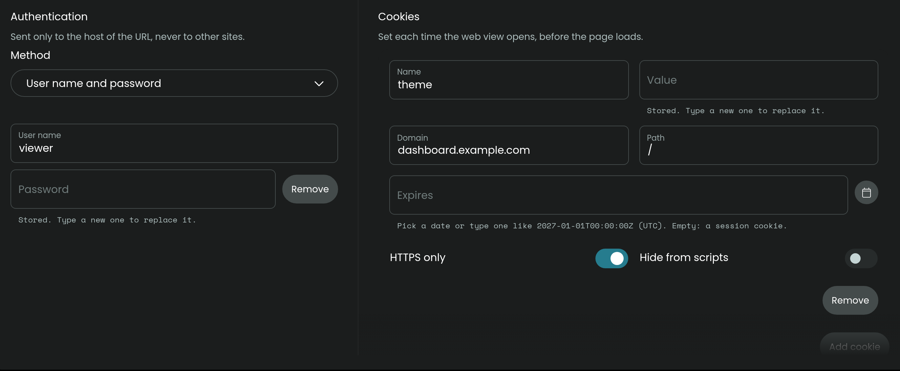
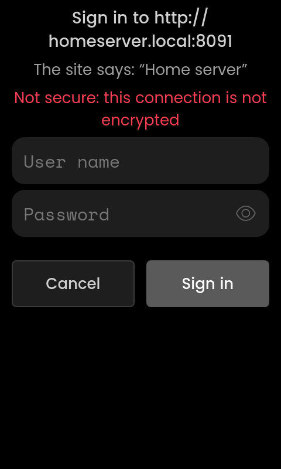
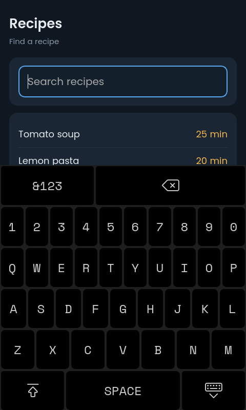
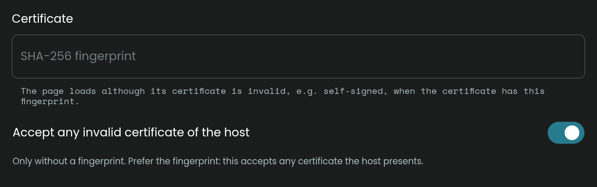
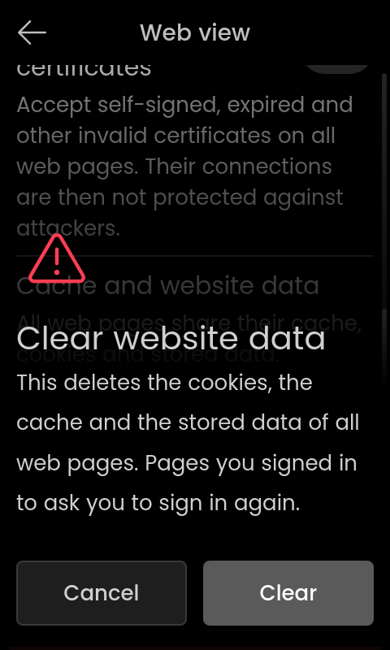

# Logins, cookies and certificates

> Applies to firmware 2.14.0 and newer, on the Remote Two and the Remote 3.

Many dashboards and status pages need a login, and home servers often use a self-signed certificate. This article shows how to set up a web view for these pages, and what the Remote stores.

## Pages that need a login

There are two ways to log in to a page.

### Option 1: Save the login in the web view

In the web-configurator, open the web view and go to the **Authentication** section. Choose a **Method**:

| Method | When to use it |
|---|---|
| **No authentication** | The page needs no login, or you log in on the Remote. |
| **User name and password** | The server asks for a user name and password in a browser login window (HTTP login). |
| **Bearer token** | The server accepts an access token, for example a long-lived token of your home automation system. |
| **Request header** | The server expects an API key in a request header. Enter the **Header name** (for example `X-API-Key`) and the **Header value**. |

Click **Save** when you're done.

Good to know:

- The login details are only sent to the host of the URL, never to other sites.
- Passwords, tokens and header values are never shown again. The field says **Stored. Type a new one to replace it.** Click **Remove** to delete a stored value.
- If you change the method and save, the stored login details of the old method are deleted.
- With an `http://` address, the login details are sent unencrypted.

> [!NOTE]
> **User name and password** only works with the server's own login window. It doesn't fill in a login form on the web page. For a login form, use option 2 or a cookie.

### Option 2: Log in on the Remote

If the web view has no saved login, you log in on the Remote:

- **Login window of the server:** the Remote shows a sign-in screen, **Sign in to** followed by the site address. Enter your **User name** and **Password** and tap **Sign in**. If the details are wrong, the screen opens again with **Wrong user name or password**. **Cancel** continues without logging in.
- **Login form on the page:** tap the fields of the form and type with the on-screen keyboard.

> [!NOTE]
> The sign-in screen is only shown when the web view is open in full screen. An activity widget shows the server's error page instead. Open the web view in full screen to log in.

If a sign-in screen shows **Not secure: this connection is not encrypted**, the site uses `http://` and your password is sent as plain text.

### Typing with the on-screen keyboard

- Tap a text field on the page to open the keyboard. Its layout matches the field, for example digits or an e-mail address.
- The D-pad and **OK** go to the text field while the keyboard is open.
- The keyboard has no Enter key. To send a form, press **OK** on the Remote, or tap the page's own button (for example "Log in").
- To close the keyboard, use its hide key. Tap the field again to open it again.

## Saved logins and cookies

All web views on the Remote share their website data: cookies, the cache and the data pages store. This means:

- When you log in to a site in one web view, the other web views of the same site are logged in too.
- A login that the site keeps in a cookie stays valid after a restart of the Remote, as long as the server accepts it.
- A user name and password typed in the sign-in screen are kept only until the Remote restarts.
- The Remote never saves passwords that you type into a page's own login form, and doesn't fill in forms automatically.

### Set cookies for a page

Some pages need a cookie, for example a session cookie or a layout preference. In the **Cookies** section of the editor, click **Add cookie** and enter:

- **Name** and **Value** (required).
- **Domain** and **Path** (optional). Without a domain, the cookie is only sent to the host of the URL.
- **Expires** (optional). Without a date, the cookie is a session cookie.
- **HTTPS only** and **Hide from scripts** (optional).

Click **Save**. A web view can have up to 20 cookies.

The cookies are set every time the web view opens, before the page loads. If the page changes or deletes a cookie, it's set back to your value the next time the web view opens.

## Self-signed certificates (home servers)

By default, a page with an invalid certificate doesn't load. This includes self-signed certificates, expired certificates and certificates of an unknown authority. The Remote shows **The page could not be loaded** and says that the certificate isn't trusted.

To allow the certificate of your server:

1. In the web-configurator, open the web view and go to the **Certificate** section.
2. Choose one option:
   - **SHA-256 fingerprint** (recommended): enter the fingerprint of your server's certificate, 64 hexadecimal digits, with or without colons. The page loads only with exactly this certificate.
   - **Accept any invalid certificate of the host**: accepts any certificate the server presents. Only use this if you can't use the fingerprint.
3. Click **Save**.

### Find the SHA-256 fingerprint

Open the same address that the web view uses in a desktop browser, then view the certificate:

- **Chrome or Edge:** click **Not secure** (or the padlock) next to the address, open the certificate details, and look for the **SHA-256** fingerprint of the certificate.
- **Firefox:** click the padlock, then **Connection not secure** > **More information** > **View Certificate**. Copy the value of **SHA-256** under **Fingerprints**.
- **Safari:** open **Show Certificate**, expand **Details**, and copy the **SHA-256** fingerprint.

Or, on a computer with OpenSSL, read the fingerprint of the certificate file:

`openssl x509 -in cert.pem -noout -fingerprint -sha256`

The web-configurator accepts the 64 hexadecimal digits without separators or separated by colons, for example `3F:A9:12:…`. Upper and lower case both work. Spaces are not accepted: if your browser shows the value with spaces, replace them with colons or remove them.

> [!NOTE]
> Use the certificate of exactly the address the web view opens. Another host name or port can present a different certificate.

Good to know:

- The exception only applies to the host of the URL. Images or scripts from other hosts with an invalid certificate don't load.
- A renewed self-signed certificate has a new fingerprint. Update the fingerprint, or the page won't load.
- An accepted certificate is accepted by all web views, and it stays accepted until the Remote restarts, even if you remove the exception.

### Allow invalid certificates for all web views

**Settings** > **Web view** > **Allow invalid certificates** (in the web-configurator or on the Remote) accepts invalid certificates on all web pages.

> [!NOTE]
> This turns off the certificate check for every page, including other sites the pages load content from. These connections are then not protected against attackers. Prefer the **Certificate** setting of a single web view.

## Clearing website data

You clear website data on the Remote, not in the web-configurator. Clearing always affects all web views, because they share their data.

1. On the Remote, open **Settings** > **Web view**.
2. Under **Cache and website data**, choose:
   - **Clear cache:** deletes cached files. You stay logged in.
   - **Clear website data:** deletes the cookies, the cache and the stored data of all web pages. Confirm with **Clear**.

What **Clear website data** removes, and what it keeps:

| Removed | Kept |
|---|---|
| Cookies, including logins that a site keeps in a cookie. These pages ask you to log in again. | The user name and password typed in a sign-in screen, until the Remote restarts. |
| The cache and the data pages store. | The login details and cookies saved in the web view settings. They are sent again automatically. |
| | Certificates you accepted, until the Remote restarts. |

Open pages reload after clearing.

You can also clear data automatically: **Settings** > **Web view** > **Website data on close** sets what is deleted each time a web page closes: **Keep** (default), **Clear cache** or **Clear all website data**. On the Remote, the settings row shows **Clear all data** as the short form of **Clear all website data**.

## Privacy notes

- The Remote never shows saved passwords, tokens, header values or cookie values again, in the web-configurator or anywhere else, and never writes them to its log.
- **Backups of the Remote contain the saved login details and cookie values of your web views.** Keep your backup files private.
- The URL of a web view is not a secret. Don't put passwords or tokens in it.
- Deleting one of your own web views deletes its saved login details and cookies. Cookies and data that the page stored itself are shared with the other web views. To remove them, use **Clear website data**.
- If you turn on **Device state API for pages**, every page the web view opens can read the battery and display state of the Remote and see when it goes into standby. Only turn it on for pages that use it.
