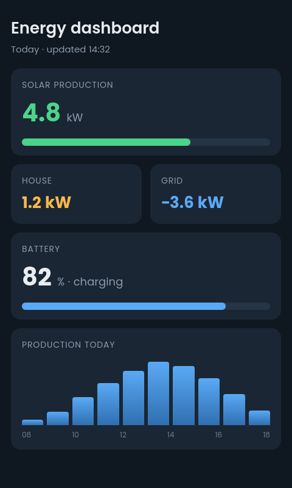
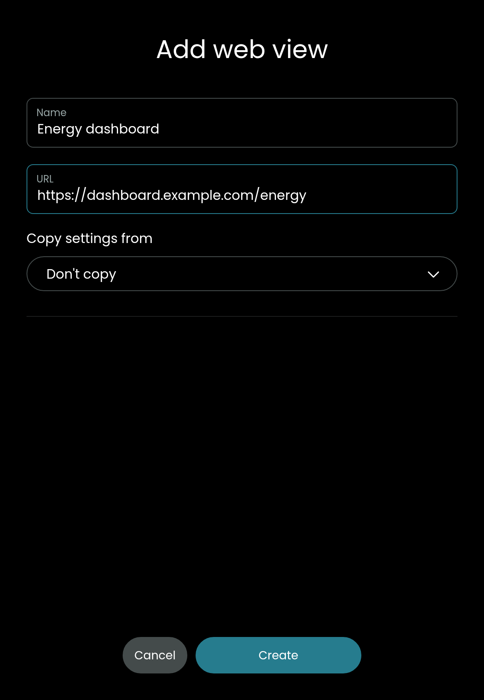
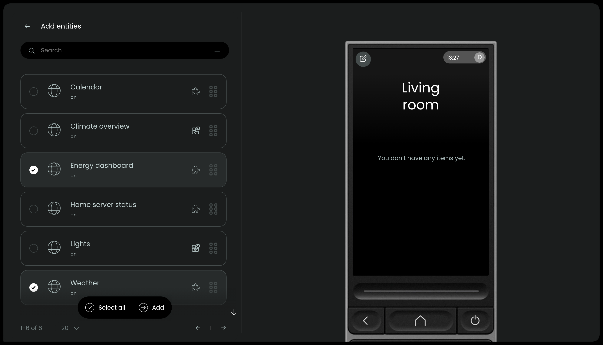

# Web views: overview and first steps

> Applies to firmware 2.14.0 and newer, on the Remote Two and the Remote 3.

A web view shows a web page on your Remote. Use it for the dashboard of your home automation system, the status page of a device, or a simple web app made for the Remote.

## What web views are good for

Web views work best with small, lightweight pages that are made for the Remote:

- **Dashboards**, for example the dashboard of your home automation system.
- **Status pages**, for example of a NAS, a solar inverter or a network device.
- **Simple web apps** and control pages with large buttons.

A web view is not a full web browser. There is no address bar and there are no tabs. Only one web page is shown at a time.

> [!WARNING]
> Web views are made for pages you trust and that are made for the Remote, such as the dashboard of your home automation system. They are not meant for browsing the internet. Don't use a web view for online banking, payments or online shopping, and don't enter sensitive personal information in it, such as credit card numbers, identity documents or health data. The Remote doesn't show the address of the page or whether the connection is secure, so you can't check which website you're on.

The Remote has limited memory, processing power and battery. Large websites with lots of scripts, images or animations load slowly, react sluggishly and drain the battery.

> [!TIP]
> For the best result, use pages that are designed for a small portrait touch screen: large buttons, no horizontal scrolling, and updates at reasonable intervals.

### What a web view can't do

- Play audio or video, including camera streams.
- Use the microphone, your location or notifications.
- Download files or show PDF documents.
- Open several pages at once. A link that opens a new window opens in the same web view.
- Use the full-screen mode of a page.
- Save passwords or fill in forms automatically.
- Use client certificates.
- Run browser extensions, for example ad blockers.

## Requirements

- **Firmware 2.14.0 or newer.**
- **Remote Two** or **Remote 3**.
- The web page must be reachable from the Remote, for example on your home network. Only addresses that start with `http://` or `https://` work.

> [!NOTE]
> Pinch-to-zoom might not be available on all Remote models. You can always zoom with the buttons of the Remote or set a fixed zoom in the web view settings.

## Your own web views and web views from integrations

There are two kinds of web views:

| Kind | Where it comes from | What you can change |
|---|---|---|
| **Own web views** | You create them in the web-configurator. | Everything: address, login, cookies, zoom, buttons and more. |
| **Web views from integrations** | An integration offers them, for example a ready-made dashboard of the connected system. | Name, icon and description. You can also override the zoom, the reload interval, the navigation controls, the device state API and the buttons. The address and the login belong to the integration. |

You add a web view from an integration like any other entity of that integration.

## Quick start

### 1. Add a web view in the web-configurator

1. Open the web-configurator and go to **Entities**.
2. Select the **Web views** tab.
3. Click **Add web view**.
4. Enter a **Name** and the **URL** of the page, for example `https://dashboard.example.com/energy`.
5. Click **Create**.

The editor of the new web view opens. You can change its settings right away, or later. See [Setting up a web view in the web-configurator](set-up.md).

### 2. Put it on a page or in an activity

You have three options:

- **On a page of the Remote:** add the web view to a page like any other entity. In the web-configurator, go to **Customize your remote** > **Pages**, choose a page, select **Edit contents** and add the web view. On the Remote, you can also add it to a page directly; use the **Web view** filter in the entity list to find it. The web view appears as a tile.
- **In an activity:** add the web view to the activity's included entities. In the activity's **User interface**, you can then add a **Web view** widget that shows the page right on an activity page.
- **With a command:** like other entities, a web view can be opened by a button, an icon or text on an activity page, a macro, or a step of an activity sequence.

See [Using web views on the Remote](using-on-the-remote.md) for details.

### 3. Open it on the Remote

1. Go to the page with the web view tile.
2. Tap the tile.

The page opens in full screen. Press **BACK** or **HOME** to close it.

> **Tip:** If the page asks you to log in, or uses a self-signed certificate (common on home servers), see [Logins, cookies and certificates](logins-cookies-certificates.md).

## Related articles

- [Setting up a web view in the web-configurator](set-up.md)
- [Logins, cookies and certificates](logins-cookies-certificates.md)
- [Using web views on the Remote](using-on-the-remote.md)
