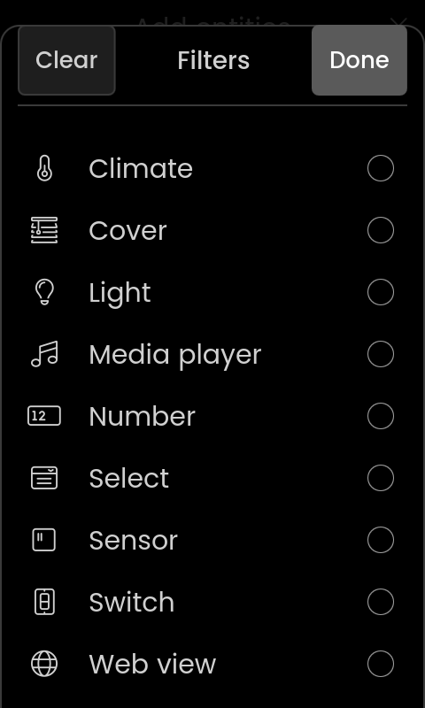
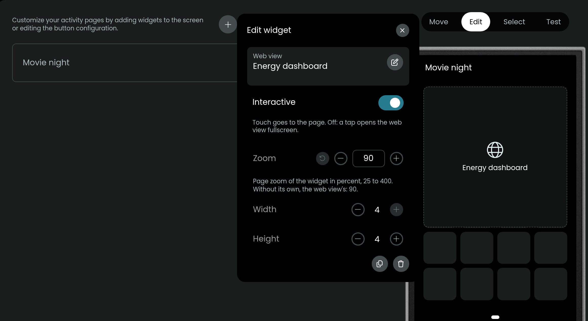
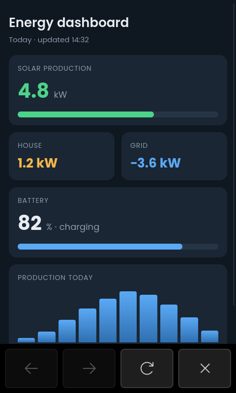
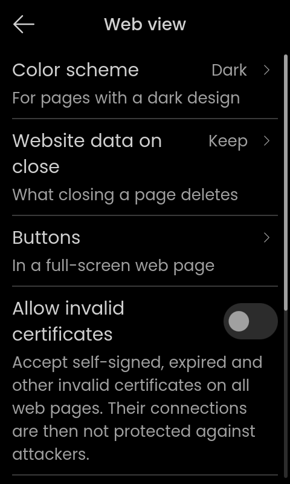

# Using web views on the Remote

> Applies to firmware 2.14.0 and newer, on the Remote Two and the Remote 3.

This article explains how to open a web view on the Remote, how to use the page with touch and buttons, and what to do when something doesn't work.

## Opening a web view

- **From a page:** tap the web view tile. The page opens in full screen. It isn't loaded until you tap the tile.
- **In an activity:** a **Web view** widget shows the page right on the activity page. If the widget isn't interactive, tap it to open the page in full screen. You can also open the web view from the list of entities in the activity.
- **With a command:** a button, an icon or text on an activity page, a macro or a step of an activity sequence can open the web view. It opens in full screen on top of the current screen, and the display wakes up.

To add a web view to a page on the Remote, use the entity list and its **Web view** filter.

Press **BACK** to close the full-screen web view and return to the previous screen. **HOME** closes it and shows the home screen.

> [!NOTE]
> Only one web page is shown at a time. While a web view is open in full screen, an activity widget unloads its page and loads it again afterwards.

### Activity widget

In the web-configurator, add the web view to the activity's included entities, then add a **Web view** widget in the activity's **User interface**:

- One web view widget per activity, at least 3 × 3 grid fields.
- **Interactive:** when on, touch goes to the page. When off, a tap opens the web view in full screen.
- The widget can have its own zoom. Without it, it uses the zoom of the web view.
- The buttons of the Remote keep the activity's button mapping.

## Touch, scrolling and zoom

- **Tap** to click a link or a button.
- **Drag** to scroll.
- **Pinch** with two fingers to enlarge the page, from 1× to 4×. Pinch-to-zoom might not be available on all Remote models.
- A long press counts as a tap. Double tap doesn't zoom.

**Zoom with buttons:** press **VOLUME +** and **VOLUME −** to zoom in steps from 50 % to 300 %. A label at the top shows the zoom level. The zoom lasts until you close the web view. To change the zoom permanently, set **Zoom** in the web view settings in the web-configurator.

## Navigation bar

If **Show navigation controls** is on for the web view, a bar at the bottom of the full-screen web view has four buttons: back, forward, reload and close.

## On-screen keyboard

Tap a text field on the page to open the keyboard. While it's open, the D-pad and **OK** go to the text field. The keyboard has no Enter key: press **OK** on the Remote to send a form. See [Logins, cookies and certificates](logins-cookies-certificates.md) for more.

## How the buttons work in a page

In the full-screen web view, the buttons have these functions by default:

| Button | Default function |
|---|---|
| D-pad | Sends the arrow keys to the page |
| OK | Sends Enter to the page |
| BACK | Closes the web view |
| VOLUME + / − | Zoom in / out |
| CHANNEL up / down | Scroll up / down one screen |
| MENU (Remote 3) | Sends the menu key to the page |
| HOME | Closes the web view and shows the home screen (can't be changed) |
| POWER, voice button | Keep their normal function (can't be changed) |
| All other buttons | Keep their normal function, for example the button mapping of the activity |

You can change the buttons for all web views in **Settings** > **Web view** > **Buttons**, and for a single web view on its **Button mapping** tab in the web-configurator. See [Setting up a web view in the web-configurator](set-up.md).

While the on-screen keyboard or a dialog of the page is open, the zoom buttons do nothing.

### Dialogs of the page

Messages and questions of the page appear as dialogs on the Remote. If you leave a page with unsaved changes, the Remote may ask **Leave this page?** Choose **Stay** or **Leave**.

## Settings > Web view on the Remote

On the Remote, open **Settings** > **Web view**. These settings apply to all web views:

| Setting | What it does |
|---|---|
| **Color scheme** | **Dark** or **Light**. Only pages that offer a dark design follow this setting. |
| **Website data on close** | What closing a page deletes: **Keep**, **Clear cache** or **Clear all website data** (shown as **Clear all data** in the row). |
| **Buttons** | What the buttons do in a full-screen web page. A web view can change single buttons. |
| **Allow invalid certificates** | Accepts invalid certificates on all web pages. Not recommended. |
| **Cache and website data** | **Clear cache** and **Clear website data** for all web views. |
| **Web view test** | Load any web address to try it. |

### Web view test

**Web view test** opens a test page with an address field. Use it to check that web views work on your Remote, or to try a page before you set up a web view for it:

1. Open **Settings** > **Web view** > **Web view test**.
2. Tap the **Web address** field and type the address. An address without `http://` or `https://` gets `http://` added.
3. Tap **Load**, or press **OK**.

The buttons below the address go back, forward, and stop or reload the page. A status line shows the page title, the load progress, or why the page couldn't be loaded. Press **BACK** to close the test page.

> [!NOTE]
> The test page doesn't use the settings of your web views, such as their login, cookies or certificate exception. A page that needs these may not load in the test, but work in its web view.

## When the display turns off and in standby

- When the display turns off, the page is hidden and paused. It stops drawing and uses less power. A dimmed display doesn't pause the page.
- The automatic reload stops while the display is off. When the page shows again, the full interval starts again.
- The page stays open and keeps its state, for example what you entered or where you scrolled to. It isn't reloaded automatically when the display turns on again or the Remote wakes up from standby.
- Right after waking up, the network may need a moment. Some pages show old data until they reconnect.

Pages that use the **Device state API for pages** can react to the display state and to standby, for example to update their data after waking up.

## Troubleshooting

### The page doesn't load, or a certificate error appears

The web view shows **The page could not be loaded**. Below it, the Remote says why, if it knows the reason:

| Message on the Remote | What to check |
|---|---|
| The server … wasn't found. | The address in the web view's **URL**, and that the Remote is connected to Wi-Fi. A name that ends in `.local` only works in your home network. |
| The Remote isn't connected to a network. | The Wi-Fi connection of the Remote. |
| … refused the connection. | That the server is running and that the port in the URL is correct. |
| … didn't respond in time. | That the server is switched on and reachable from the Remote's network, for example not blocked by a firewall or in another network. |
| The certificate of … isn't trusted. | For a home server with a self-signed certificate, allow the certificate in the web view's **Certificate** settings. See [Logins, cookies and certificates](logins-cookies-certificates.md). |
| Only http:// and https:// addresses can be opened. | The **URL** must start with `http://` or `https://`. |
| The page stopped working. | Try again. If it happens again, the page may not work on the Remote. |
| The page needs more memory than the Remote has. | The page is too large for the Remote. Use a smaller page, for example a simpler dashboard view. |

- Select **Try again** or press **OK** to load the page again.
- Select **Details** to see the technical error, for example to send it to our support or to the maker of the page. It shows only the server's address, not the rest of the URL.
- An activity widget shows the reason only if there's room for it, and has no buttons. Tap an interactive widget to try again. Tap a widget that isn't interactive to open the web view in full screen, where **Details** is available.
- If the web view of an integration is unavailable, check the integration and the connected system.
- PDF documents and downloads aren't supported. The Remote shows **PDF documents cannot be shown here** or **Downloads are not supported**.

### I'm asked to log in again

- A user name and password typed in the sign-in screen are kept only until the Remote restarts. Save the login in the web view's **Authentication** settings instead.
- **Clear website data**, or **Website data on close** set to clear all data, logs you out of pages that use a cookie login.
- The site may have ended your session. Log in again.
- If a sign-in fails after the sign-in screen was open for a long time, reload the page and try again.

### The page is too small or too large

- Press **VOLUME +** or **VOLUME −** to zoom for this visit.
- Set **Zoom** in the web view settings to keep a zoom level.
- Try **Mobile browser** or **Desktop browser** in **User agent** to get another layout of the page.
- For an activity widget, set the zoom of the widget.

### A button does nothing

- **HOME**, **POWER** and the voice button have fixed functions.
- Check the web view's **Button mapping** tab and **Settings** > **Web view** > **Buttons**. A button set to **Nothing** does nothing, and a key sent to the page only works if the page handles it.
- In an activity widget, the buttons use the activity's button mapping.
- The zoom buttons do nothing while the keyboard or a dialog is open.

### The page isn't updated after standby

The page is paused while the display is off and isn't reloaded after waking up.

- Reload the page: use the reload button of the navigation bar, or a button set to **Reload**.
- Set a **Reload interval** in the web view settings.
- If you made the page yourself, use the **Device state API for pages** to update it after standby.

### I can't add another web view

The web-configurator shows "You have 1000 own web views, the most the Remote can have." Delete web views you no longer need. Web views from integrations don't count toward this limit.
